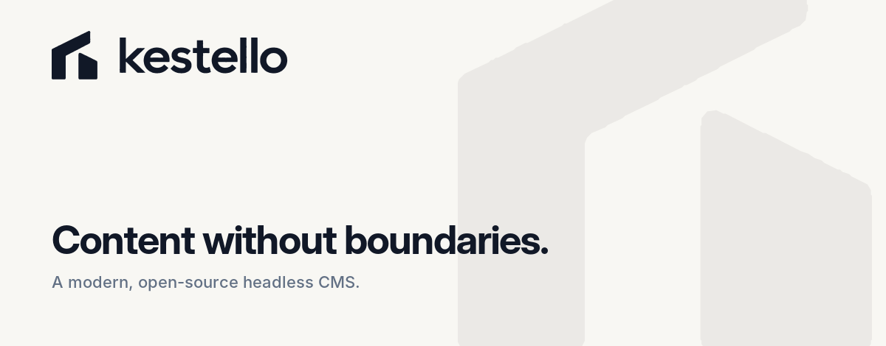

<picture>
  <source media="(prefers-color-scheme: dark)" srcset="banner-dark.png">
  
</picture>

Kestello is a free, self-hosted content management system for the people who run a website and the developers who build it. Editors change the real page in a visual editor. Developers add anything through plugins and themes, and core stays untouched.

**[Website](https://kestello.com)** · **[Documentation](https://docs.kestello.com)** · **[Source](https://github.com/kestellohq/cms)**

Kestello is preparing its first release, 0.1.0. Releases will appear on the [cms releases page](https://github.com/kestellohq/cms/releases), and a Kestello site installs signed updates from there itself.

### Repositories

| Repository | What it holds |
| --- | --- |
| [cms](https://github.com/kestellohq/cms) | Kestello itself: the admin, the visual editor, the HTTP API and the Base theme |
| [docs](https://github.com/kestellohq/docs) | The documentation at [docs.kestello.com](https://docs.kestello.com), for site owners and developers |
| [plugins](https://github.com/kestellohq/plugins) | Official plugins: Meilisearch and Typesense search, and sign-in with Google or GitHub |
| [examples](https://github.com/kestellohq/examples) | Example plugins and a child theme to learn from |

### Built with

PHP 8.4 and Vue, with no Composer dependencies. MySQL, MariaDB, PostgreSQL or SQLite. Ordinary shared hosting is enough.

### Take part

- **Contribute:** read [CONTRIBUTING.md](https://github.com/kestellohq/cms/blob/develop/CONTRIBUTING.md) before opening an issue or a pull request.
- **Report a security problem** privately, through the repository's **Security** tab. Please don't open a public issue. See the [security policy](https://github.com/kestellohq/cms/blob/develop/SECURITY.md).
- **Be kind:** everyone taking part follows the [code of conduct](https://github.com/kestellohq/.github/blob/main/CODE_OF_CONDUCT.md).

Kestello is free software under the [GNU General Public License, version 2 or later](https://github.com/kestellohq/cms/blob/develop/LICENSE).
